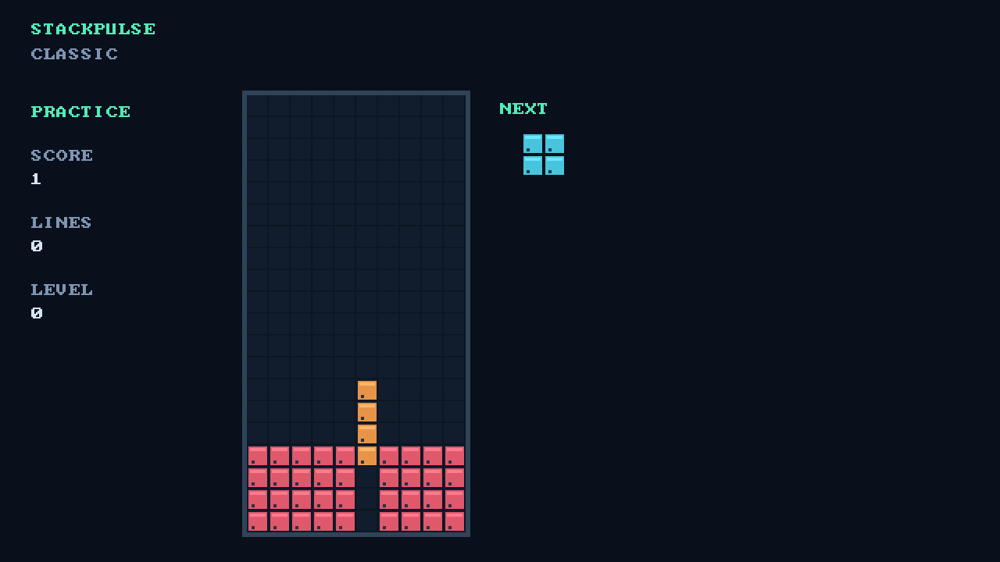
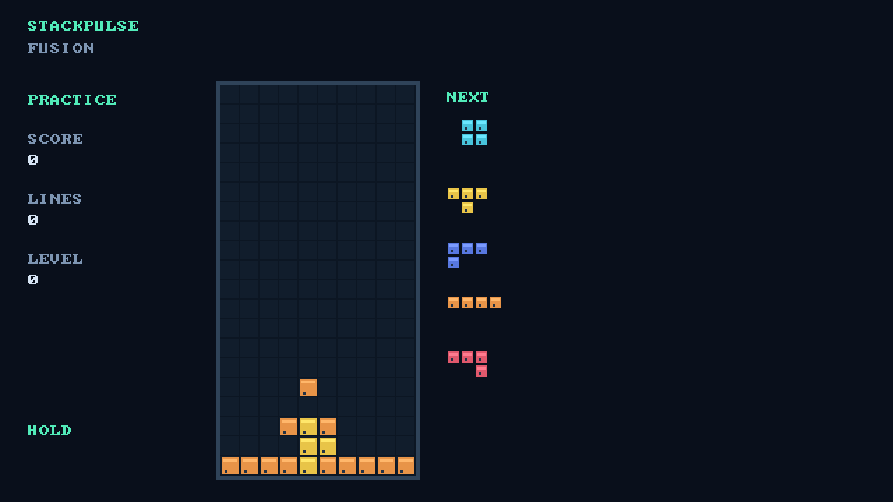
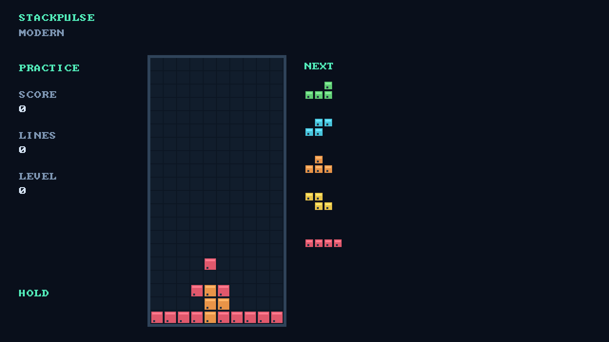
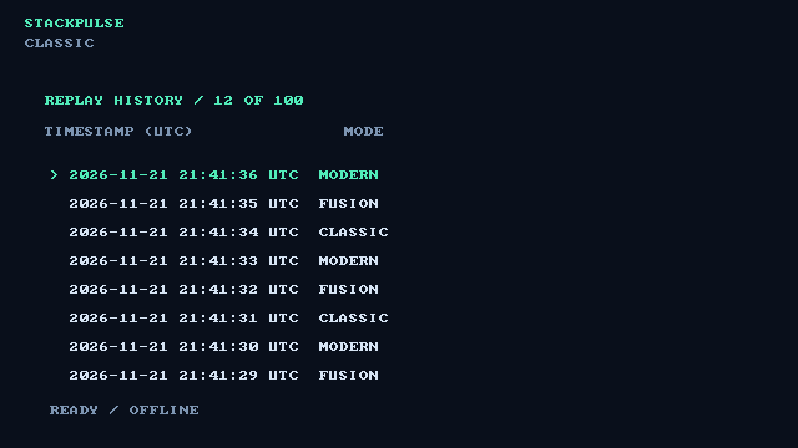

# Stackpulse

A native C++20 / SDL3 falling-block game with three modes, offline practice and authoritative multiplayer rooms. This is a private alpha: gameplay and file formats can change, and Classic uses independently authored provisional rules. Reference fidelity is unverified.

- **Classic**: one preview, immediate locking, no hold or hard drop.
- **Fusion**: Classic-style progression with five previews, hold, kicks and spins.
- **Modern**: five previews, hold, ghost, hard drop and delayed locking.
- **Practice Lab**: repeatable seeds, frame stepping, clear/spin fixtures and input diagnostics.
- **Replays**: local recording, a replay browser and deterministic playback with independent verification tools.
- **Multiplayer**: server-authoritative rooms for 2–8 players, spectators, optional passwords and rematches. Each room chooses its mode.

No ROM, external font or asset download is needed to play. Graphics and synthesized sounds are original.

## Screenshots

| Classic | Fusion |
| --- | --- |
|  |  |
| **Modern** | **Replay browser** |
|  |  |

## Play the release

Extract the entire Windows x64 ZIP into a writable folder and run `stackpulse_client.exe`. Keep its bundled runtime DLLs and `licenses/` directory together. In this working project, the latest extracted release is available at:

```powershell
.\out\release\stackpulse_client.exe
```

Choose a mode, then Marathon or Practice. Default controls are **Left/Right** to move, **Down** to soft drop, **X/Z** to rotate and **Escape** to pause. **C** holds in Fusion/Modern; **Space** hard drops in Modern. Menus use Up/Down and Enter. Keyboard and gamepad bindings are configurable in Settings. See the [client guide](apps/client/README.md) for the full controls, replay navigation and save locations.

For local multiplayer, start the dedicated server, then choose Multiplayer in each client:

```powershell
.\out\release\stackpulse_server.exe
.\out\release\stackpulse_client.exe --connect 127.0.0.1
```

The server listens on loopback UDP port **27877** by default. At least two players must join and everyone must ready up to start. To host on a LAN, pass `--bind` with the server's LAN address and allow its UDP port through the host firewall; clients connect to that address. Use `--port N` on both programs to change the port. Public matchmaking and NAT traversal are not supplied.

The Linux graphical client can now be built with `linux-release` and packaged as
`stackpulse-linux-x64.tar.gz`. Extract that archive in a Linux desktop session and
run `./play.sh`; it includes the same game, replays and multiplayer UI as Windows.
See [Linux client setup and validation](docs/LINUX_CLIENT.md). The existing first
GitHub release's `stackpulse-linux-x64-server.tar.gz` asset is still server-only.

The separate Linux x64 server archive contains the SDL-free server and command-line tools:

```sh
./stackpulse_server --bind 127.0.0.1 --port 27877
```

It requires compatible system glibc, libstdc++, libgcc and an ELF loader. Check the archive's `RUNTIME_DEPENDENCIES.txt` and validate it on the deployment distro. The Windows package includes app-local Visual C++ runtime DLLs; relocated smoke checks do not establish clean-machine compatibility. Package contents, checksums and validation scope are described in [packaging](docs/PACKAGING.md).

## Build from source

Windows prerequisites: Git, Visual Studio 2026 with **Desktop development with C++**, and CMake supporting the **Visual Studio 18 2026** generator. CMake 4.5.0-rc2 was tested on this host; the project's CMake 3.25 minimum also supports older generators. The first configure fetches pinned SDL 3.2.28, Catch2 3.8.1 and ENet 1.3.18 source revisions.

```powershell
cmake --preset windows-debug
cmake --build --preset windows-debug -- /m:1 /p:BuildInParallel=false
ctest --preset windows-debug
.\out\build\windows-debug\Debug\stackpulse_client.exe
```

Visual Studio 2022 users can select `-G "Visual Studio 17 2022"` with the configure preset in a fresh build directory. For a Release build, run `cmake --build out/build/windows-debug --config Release`; the release packaging tool and prerequisites are documented in [PACKAGING.md](docs/PACKAGING.md).

Linux development uses Clang, Ninja, CMake and SDL's desktop development prerequisites; [CI](.github/workflows/build.yml) lists the packages used by the Ubuntu build:

```sh
cmake --preset linux-debug
cmake --build --preset linux-debug
ctest --preset linux-debug
```

For the graphical Release build, install the desktop dependencies listed in the
Linux client guide, then use the default system C++ compiler:

```sh
cmake --preset linux-release
cmake --build --preset linux-release --parallel 3
ctest --preset linux-release
./out/build/linux-release/stackpulse_client
```

The `server` preset builds the SDL-free dedicated server and tools with ENet. The `headless` preset builds dependency-free offline tools with a C++20 compiler and Ninja. `STACKPULSE_BUILD_NETWORK=OFF` omits ENet and online play. Cached dependency sources support later offline builds; `STACKPULSE_FETCH_DEPENDENCIES=OFF` supports installed package configs, but that alternative remains unverified.

## Compatibility and project docs

Classic records `SPCR` container v1 with provisional rules/state v4. Fusion/Modern record `SPMR` v6. Earlier rules/state identities reject explicitly; recordings are local simulation inputs and cannot reproduce authoritative multiplayer attacks. The separate proposed SPR1 network replay format is not implemented. See the [replay contract](docs/specs/replay-v1.md), [Classic behavior ledger](docs/specs/classic-reference.md) and [current room protocol](src/protocol/README.md).

- [Client guide and controls](apps/client/README.md)
- [Design](docs/GAME_DESIGN.md) and [development plan](docs/DEVELOPMENT_PLAN.md)
- Validation records: [M0](docs/M0_VALIDATION.md), [M1](docs/M1_VALIDATION.md), [M2](docs/M2_VALIDATION.md), [M3](docs/M3_VALIDATION.md), [M4](docs/M4_VALIDATION.md)
- [Contracts and proposed formats](docs/specs/) — individual documents distinguish implemented behavior from drafts
- [Packaging and release checks](docs/PACKAGING.md), [third-party notices](THIRD_PARTY_NOTICES.md) and [formatting](docs/FORMATTING.md)
