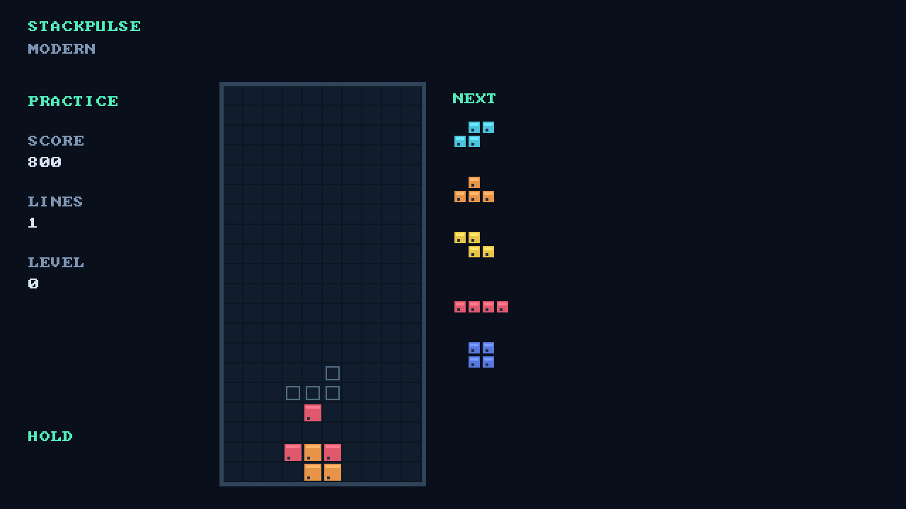

# Linux desktop client

The SDL client now has a Linux Release build and a graphical client package. It
shares the Windows game's Classic, Fusion, Modern, Practice Lab, settings, replay
and multiplayer implementations. The existing Linux server-only archive remains
available separately.



## Build

On Ubuntu/Debian, install a C++20 compiler, CMake 3.25 or newer, Ninja and SDL's
desktop development libraries. The Release preset uses the default C++ compiler;
the Debug preset specifically selects Clang.

```sh
sudo apt-get update
sudo apt-get install build-essential cmake ninja-build pkg-config libx11-dev libxext-dev libxrandr-dev libxcursor-dev libxi-dev libxfixes-dev libxss-dev libxtst-dev libwayland-dev libxkbcommon-dev libegl1-mesa-dev libasound2-dev libpulse-dev libudev-dev
cmake --preset linux-release
cmake --build --preset linux-release --parallel 3
ctest --preset linux-release
./out/build/linux-release/stackpulse_client
```

The first configure downloads the pinned SDL, Catch2 and ENet sources. Existing
FetchContent source overrides remain supported. Under WSL, build and run inside
the Linux environment; a Linux filesystem build directory is preferable for
performance. WSLg supplies the X11/Wayland desktop and PulseAudio connection.

## Package and run

```sh
python3 tools/package_linux_client.py --bin-dir out/build/linux-release --sdl-license out/build/linux-release/_deps/sdl3-src/LICENSE.txt --enet-license out/build/linux-release/_deps/enet-src/LICENSE
tar -xzf out/packages/stackpulse-linux-x64.tar.gz -C /path/to/empty/folder
/path/to/empty/folder/play.sh
```

Pass the actual SDL/ENet license paths if using source overrides. The launcher
forwards options, for example `play.sh --mode modern` or
`play.sh --connect 127.0.0.1`. Preferences/replays use SDL's per-user data location;
`--data-dir PATH` selects another writable directory. The extracted package does
not need to be the current working directory.

On a cold WSLg start, the launcher waits up to five seconds for its PulseAudio
socket before starting the game. Muted, driver-list and verification commands
skip this wait. A normal Linux desktop is unaffected. If audio remains
unavailable, the game still runs and reports the audio initialization error.

The package includes the graphical game, server and tools, SDL/ENet licenses,
runtime dependency information and a SHA-256 manifest. SDL is linked into the
client, but graphics/audio drivers and compatible C/C++ runtimes come from the
target system. Inspect `RUNTIME_DEPENDENCIES.txt` for the build's required symbol
versions and compiled SDL backends. This initial build is not an AppImage or a
claim of compatibility with every Linux distribution.

The initial local archive was built on Ubuntu 26.04 under WSLg with GCC 15.2.
Its client requires glibc 2.43; build from source on your target distribution
if it provides an older runtime. A broadly compatible downloadable release
still needs a build on an older supported Linux baseline.

## Troubleshooting

`stackpulse_client --list-drivers` lists the compiled video/audio backends without
opening a window. Startup logs identify the selected video renderer and audio
driver. A missing display produces an initialization error rather than silently
exiting. To select a backend explicitly:

```sh
SDL_VIDEO_DRIVER=x11 SDL_RENDER_DRIVER=software ./play.sh
SDL_VIDEO_DRIVER=wayland ./play.sh
SDL_AUDIO_DRIVER=pulseaudio ./play.sh
./play.sh --mute
```

SDL also accepts the older `SDL_VIDEODRIVER` and `SDL_AUDIODRIVER` environment
names. Controller access depends on the Linux desktop's device permissions;
physical devices under WSL may require USB forwarding. A dummy audio/video smoke
test does not establish hardware/controller compatibility.

## Validation

The Release test preset uses explicit dummy video/audio drivers for repeatable
headless tests. The packager also verifies the extracted launcher from a path
containing spaces and an unrelated working directory, rendering all three modes.
Real desktop checks are recorded separately after the build; CI packaging smoke
does not stand in for a real display or cross-distribution acceptance test.

Local validation on Ubuntu/WSLg passed all five CTest suites, extracted-package
checks for Classic/Fusion/Modern, and a native room with eight clients and a
spectator. Seven desktop launches passed: all three modes on X11 and Wayland
with software rendering, plus Modern with the default OpenGL renderer. Each
initialized PulseAudio and captured a rendered frame. Wayland software launches
reported Mesa/EGL probe warnings but completed successfully. Physical controller
input, speaker output and other Linux distributions have not been manually tested.
